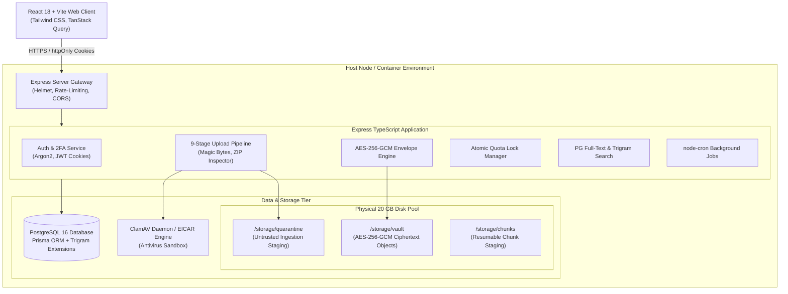
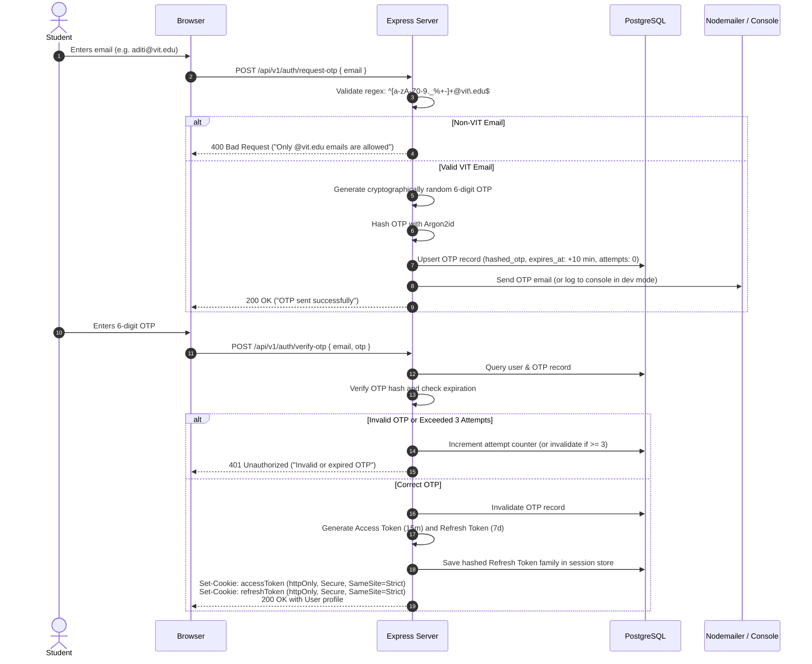
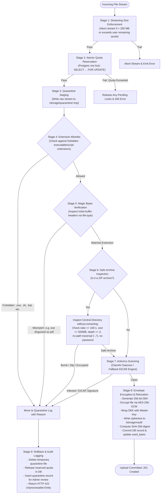
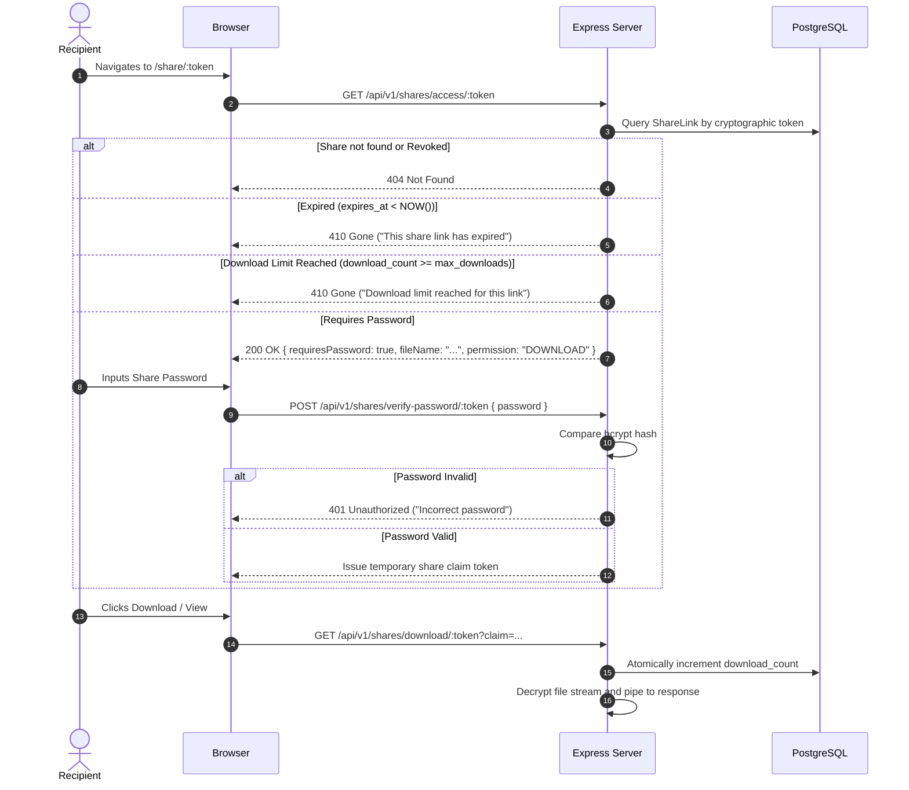
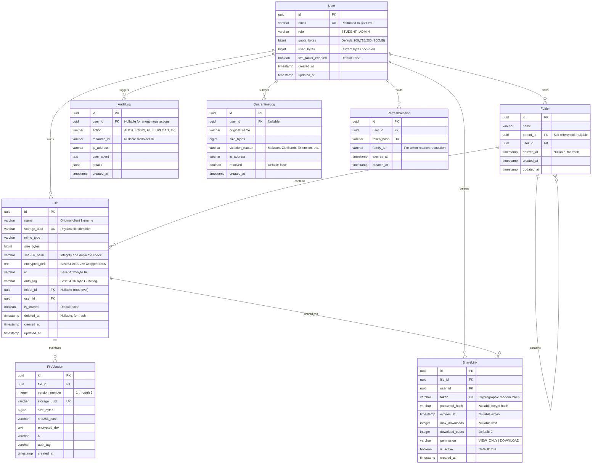
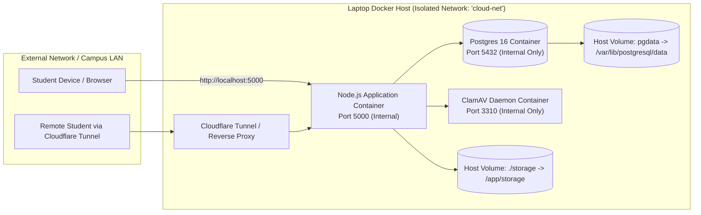

# System Architecture Document
## Private Cloud Storage System (Cloud Computing Course Project)

> **What this document is and how to use it:**  
> This document details the architectural design, security pipelines, data models, cryptographic mechanisms, concurrency controls, and operational workflows of the Private Cloud Storage platform. It provides engineers, instructors, and evaluators with a thorough, transparent explanation of how the system fulfills its requirements, handles edge cases, and balances performance with rigorous security.

---

## 1. High-Level System Overview

The Private Cloud Storage system is a secure, multi-tenant cloud storage engine designed to run on a single host machine (e.g., student laptop) utilizing a dedicated **20 GB physical disk pool**. It provides isolated, encrypted virtual storage for university students authenticated via their institutional `@vit.edu` email credentials, enforcing a strict **200 MB personal quota** per student.

The architecture emphasizes three core principles:
1. **Defense-in-Depth:** Every upload traverses an isolated 9-stage verification pipeline before any payload is committed to permanent storage.
2. **Cryptographic Privacy:** Files on disk are stored as AES-256-GCM ciphertext using envelope encryption (per-file DEK wrapped by a master key). Plaintext is never exposed in the file pool.
3. **Strict Resource Isolation & Concurrency Control:** Storage quotas are treated like financial ledgers. Quota reservations are committed atomically using database row-level locking (`SELECT ... FOR UPDATE`), preventing concurrent uploads from overshooting limits.



---

## 2. Component Responsibilities

| Component | Technology | Primary Responsibilities |
|---|---|---|
| **Client Application** | React 18, Vite, TypeScript, Tailwind CSS | Single-page UI, chunked file slicing, drag-and-drop file browser, inline previews (PDF, images, text), storage analytics (Recharts), share management. |
| **API Gateway / Server** | Node.js 20, Express, TypeScript | Request routing, security middleware (Helmet, strict CSP, rate-limiting, CORS), error normalization, and response serialization. |
| **Auth Service** | Nodemailer, Argon2, JSON Web Tokens | Generates and verifies 6-digit OTPs, enforces `@vit.edu` domain restriction, issues and rotates Access/Refresh JWT cookies. |
| **Upload Pipeline Engine** | Busboy streaming, file-type, yauzl, ClamAV client | Streams incoming bytes to quarantine, enforces size bounds, checks magic bytes, inspects zip central directories without extraction, scans for malware. |
| **Cryptography Service** | Node.js `node:crypto` | Implements envelope encryption using AES-256-GCM. Generates unique per-file Data Encryption Keys (DEKs), encrypts files, wraps DEKs with the master key. |
| **Quota & Concurrency Manager** | PostgreSQL raw SQL row locking | Acquires exclusive row locks (`SELECT ... FOR UPDATE`) on user storage records to reserve upload allocations atomically. |
| **Database & ORM** | PostgreSQL 16, Prisma ORM | Relational metadata storage (users, files, folders, shares, versions, audit logs), full-text search indexing, trigram similarity matching. |
| **Storage Vault** | Host File System | Stores encrypted binary blobs under non-guessable UUID filenames in `/storage/vault/`. Files have no extension or human-readable names on disk. |
| **Background Scheduler** | node-cron | Executes automated jobs: 30-day Recycle Bin auto-purge, orphan upload chunk cleanup, quota reconciliation, and expired share-link deactivation. |

---

## 3. Detailed Request Flows

### 3.1 Authentication & Session Issuance (OTP + 2FA Flow)



---

### 3.2 The 9-Stage Upload Defense Pipeline

Every uploaded file undergoes an uncompromising, sequential 9-stage validation pipeline. If any stage fails, the process halts immediately, the file is rejected, reserved quota is rolled back, and the incident is recorded in the quarantine log.



#### Detailed Stage Specifications:

1. **Stage 1 (Streaming Size Enforcement):** The server monitors the byte count during upload streaming (via Busboy). If incoming bytes exceed either the maximum permissible single-file size or the user's available quota space, the stream is abruptly truncated, destroying the network socket and preventing memory exhaustion.
2. **Stage 2 (Atomic Quota Reservation):** Within an explicit PostgreSQL transaction, the backend executes:
   ```sql
   SELECT id, quota_bytes, used_bytes FROM "User" WHERE id = $1 FOR UPDATE;
   ```
   If `used_bytes + incoming_bytes > quota_bytes`, the transaction aborts with HTTP 400. Otherwise, the incoming byte count is temporarily marked as reserved.
3. **Stage 3 (Quarantine Ingestion):** Incoming bytes are written exclusively to `/storage/quarantine/<quarantine_uuid>.tmp`. At no point is an unverified file placed in the public or permanent file directories.
4. **Stage 4 (Extension Allowlist):** The file extension is sanitized and checked against a strict denylist of executable and script extensions:
   `['.exe', '.bat', '.cmd', '.sh', '.ps1', '.msi', '.js', '.vbs', '.jar', '.scr', '.dll', '.com', '.hta', '.pif', '.reg', '.iso', '.vhd']`.
5. **Stage 5 (Magic Bytes Verification):** The file's first 4,100 bytes are inspected using `file-type` to verify the actual binary signature against the claimed extension. A file named `assignment.pdf` that begins with the `MZ` (DOS/PE executable) or `\x7fELF` header is immediately rejected.
6. **Stage 6 (Safe Archive Inspection without Extraction):** If the file is an archive (e.g., `.zip`):
   - The Central Directory is parsed using `yauzl` without decompressing file contents.
   - **Zip-Slip Check:** Every entry name is inspected; entries containing `../`, leading slashes `/`, or absolute Windows paths `C:\` trigger immediate rejection.
   - **Compression Ratio Check:** The sum of uncompressed sizes is compared against the compressed archive size. Ratios exceeding 100:1 (indicating zip bombs like 42.zip) are rejected.
   - **Resource Limits:** Archives with > 1,000 files, total uncompressed size > 500 MB, or nesting depth > 3 levels are rejected.
   - **Encryption:** Password-protected archives are rejected because their internal payloads cannot be inspected.
7. **Stage 7 (Antivirus Scanning):** The file is streamed to the ClamAV daemon via TCP or UNIX domain socket (`INSTREAM` command). If ClamAV detects a virus, the upload is blocked. If ClamAV is offline or running in standalone dev mode, the internal fallback scanner scans the buffer for malicious patterns, including the standard EICAR test string (`X5O!P%@AP[4\PZX54(P^)7CC)7}$EICAR-STANDARD-ANTIVIRUS-TEST-FILE!$H+H*`).
8. **Stage 8 (Envelope Encryption, Persistence & Commit):**
   - Generate a unique 256-bit Data Encryption Key (DEK).
   - Generate a 96-bit Initialization Vector (IV).
   - Stream the quarantine file through an `AES-256-GCM` cipher, outputting ciphertext to `/storage/vault/<file_uuid>.enc`.
   - Extract the 128-bit GCM Authentication Tag.
   - Encrypt (wrap) the DEK using the application Master Key (`STORAGE_MASTER_KEY`).
   - Calculate the plaintext's SHA-256 cryptographic checksum.
   - In a DB transaction, insert the `File` and `FileVersion` records, update the user's `used_bytes`, log `FILE_UPLOAD` in `AuditLog`, and unlink the quarantine file.
9. **Stage 9 (Rollback on Failure):** If any stage between 3 and 8 fails:
   - The temporary file in `/storage/quarantine/` is deleted.
   - The reserved quota in PostgreSQL is released.
   - A `QuarantineLog` entry is inserted recording `fileName`, `fileSize`, `violationReason`, `ipAddress`, and `userId`.
   - An HTTP 422 Unprocessable Entity error is returned to the client with the specific security violation description.

---

### 3.3 Secure File Download Flow

```mermaid
sequenceDiagram
    autonumber
    actor Student
    participant Browser
    participant Server as Express Server
    participant DB as PostgreSQL
    participant Vault as /storage/vault

    Student->>Browser: Clicks download for file (id: abc-123)
    Browser->>Server: GET /api/v1/files/abc-123/download
    Server->>Server: Verify JWT session
    Server->>DB: Query file metadata & check ownership (or active share link)
    alt Unauthorized
        Server-->>Browser: 403 Forbidden ("Access denied")
    else Authorized
        Server->>DB: Retrieve encrypted DEK, IV, auth_tag, storage_path, mime_type
        Server->>Server: Unwrap DEK using Master Key
        Server->>Vault: Open ReadStream(/storage/vault/<uuid>.enc)
        Server->>Server: Initialize AES-256-GCM Decipher with DEK, IV, auth_tag
        Server->>Browser: Set Headers:<br/>Content-Disposition: attachment; filename="sanitized.ext"<br/>X-Content-Type-Options: nosniff<br/>Content-Type: mime_type
        Server->>Browser: Pipe Decrypted Stream to HTTP Response Body
        Server->>DB: Record FILE_DOWNLOAD in AuditLog
    end
```

---

### 3.4 Share Link Access Flow



---

### 3.5 Recycle Bin Soft-Delete & Restore Flow

```mermaid
sequenceDiagram
    autonumber
    actor Student
    participant Browser
    participant Server as Express Server
    participant DB as PostgreSQL

    Student->>Browser: Clicks "Move to Trash" on file
    Browser->>Server: DELETE /api/v1/files/:id
    Server->>DB: Check ownership; UPDATE "File" SET deleted_at = NOW() WHERE id = :id
    Server->>DB: Record FILE_SOFT_DELETE in AuditLog
    Server-->>Browser: 200 OK ("File moved to Recycle Bin")
    Note over DB: Quota remains occupied (files in trash still count toward 200 MB)

    alt User Restores File
        Student->>Browser: Clicks "Restore" in Recycle Bin
        Browser->>Server: POST /api/v1/files/:id/restore
        Server->>DB: Check name conflict in original parent folder
        Server->>DB: UPDATE "File" SET deleted_at = NULL WHERE id = :id
        Server->>DB: Record FILE_RESTORE in AuditLog
        Server-->>Browser: 200 OK ("File restored successfully")
    else User Permanently Deletes File
        Student->>Browser: Clicks "Delete Forever"
        Browser->>Server: DELETE /api/v1/files/:id/permanent
        Server->>DB: Fetch file storage path & size
        Server->>Server: Unlink physical encrypted file from /storage/vault/
        Server->>DB: DELETE FROM "File" WHERE id = :id; UPDATE "User" SET used_bytes = used_bytes - size
        Server-->>Browser: 200 OK ("File permanently purged; quota released")
    else 30 Days Elapse
        Note over Server: Background Cron Job triggers at 02:00 UTC
        Server->>DB: SELECT * FROM "File" WHERE deleted_at < NOW() - INTERVAL '30 days'
        Server->>Server: Delete physical encrypted files from disk
        Server->>DB: Purge records and release quota
    end
```

---

## 4. Database Schema & Entity Relationships

The relational model is designed in PostgreSQL and managed with Prisma ORM.



### Table & Column Design Rationale
- **`File.storage_uuid` vs `File.name`:** The real filename (`name`) is strictly stored in the database. On disk, the file is named `<storage_uuid>.enc`. This prevents path traversal vulnerabilities, directory listing leaks, and filesystem encoding issues.
- **`File.encrypted_dek`, `iv`, `auth_tag`:** Envelope encryption parameters. AES-256-GCM produces a 128-bit authentication tag required to detect any ciphertext tampering.
- **`User.used_bytes` & `quota_bytes`:** Stored as 64-bit integers (`BigInt`) to prevent 32-bit integer overflow when metering gigabyte-scale storage.
- **`FileVersion.version_number`:** Tracks sequential versions (1 to 5). When version 6 is added, version 1 is pruned.
- **`RefreshSession.family_id`:** Enables RFC 6819 refresh token rotation. If an attacker uses an already-rotated token, all tokens sharing that `family_id` are revoked.

---

## 5. Repository & Directory Structure

```
Cloud_CP/
├── client/                     # Frontend Application (React 18 + Vite + Tailwind CSS)
│   ├── public/                 # Static assets, favicon, manifest
│   ├── src/
│   │   ├── api/                # TanStack Query hooks & Axios client
│   │   ├── components/         # Reusable UI component library
│   │   │   ├── ui/             # Core primitives (Button, Modal, Input, Toast)
│   │   │   ├── layout/         # Navbar, Sidebar, Breadcrumbs, MobileDrawer
│   │   │   ├── files/          # FileGrid, FileTable, FileCard, VersionModal
│   │   │   ├── upload/         # UploadDropzone, UploadProgressModal
│   │   │   ├── preview/        # FilePreviewModal (PDF, Image, Text)
│   │   │   └── dashboard/      # StorageGauge, QuotaBarChart, FilePieChart
│   │   ├── context/            # AuthContext, ThemeContext (Dark/Light)
│   │   ├── pages/              # Routed pages (Login, Files, Trash, Admin, Audit)
│   │   ├── types/              # TypeScript interfaces for models & API
│   │   └── utils/              # Formatters (bytes, dates), validation helpers
│   ├── index.html              # HTML shell with Google Fonts (Inter)
│   ├── package.json
│   ├── tailwind.config.js      # Custom theme, colors, dark mode configuration
│   ├── tsconfig.json
│   └── vite.config.ts          # Vite configuration with proxy for /api
│
├── server/                     # Backend Application (Node.js 20 + Express + TypeScript)
│   ├── src/
│   │   ├── config/             # System constants, environment parser, thresholds
│   │   ├── controllers/        # Express route handlers
│   │   ├── middleware/         # Auth, RBAC, Rate-limit, DiskGuard, Validation
│   │   ├── routes/             # API v1 routes (auth, files, folders, shares, admin)
│   │   ├── services/           # Core domain services:
│   │   │   ├── auth.service.ts         # OTP generation, verification, JWT handling
│   │   │   ├── quota.service.ts        # Atomic row-locking quota reservations
│   │   │   ├── pipeline.service.ts     # 9-stage upload validation pipeline
│   │   │   ├── crypto.service.ts       # AES-256-GCM envelope encryption/decryption
│   │   │   ├── archive.service.ts      # Safe ZIP central directory inspector
│   │   │   ├── scanner.service.ts      # ClamAV / EICAR signature antivirus scanner
│   │   │   ├── search.service.ts       # Postgres full-text & trigram search
│   │   │   └── audit.service.ts        # Structured audit logger
│   │   ├── jobs/               # Background scheduled jobs (node-cron)
│   │   │   ├── trashPurge.job.ts       # 30-day Recycle Bin cleaner
│   │   │   ├── orphanCleanup.job.ts    # Cleans abandoned upload chunks
│   │   │   └── shareExpiry.job.ts      # Flags expired share links
│   │   ├── prisma/             # Prisma schema, migrations, and seed scripts
│   │   ├── types/              # Server-side TypeScript interfaces
│   │   └── app.ts              # Express application bootstrap & middleware chain
│   ├── storage/                # Physical storage pool on host laptop (20 GB allocation)
│   │   ├── vault/              # Permanent encrypted ciphertext blobs (<uuid>.enc)
│   │   ├── quarantine/         # Staging zone for uninspected files (<uuid>.tmp)
│   │   └── chunks/             # Resumable chunk storage
│   ├── tests/                  # Automated Vitest & Supertest test suite
│   ├── package.json
│   └── tsconfig.json
│
├── docs/                       # Comprehensive documentation suite
│   ├── PRD.md                  # Product Requirements Document
│   ├── ARCHITECTURE.md         # System Architecture & Technical Specifications
│   ├── RULES.md                # Code Standards, Security Guardrails & Team Rules
│   ├── DESIGN.md               # UI/UX Design System, Wireframes & Palette
│   ├── TASKS.md                # Phased implementation tracking
│   ├── MEMORY.md               # Continuous project context & engineering log
│   ├── DEMO.md                 # Interactive presentation click-through script
│   └── VIVA.md                 # 25 Difficult Examination & Defense Questions
│
├── docker-compose.yml          # Container orchestration (App, Postgres 16, ClamAV)
├── .env.example                # Canonical environment variable specification
├── README.md                   # 15-minute quickstart guide for evaluators
└── package.json                # Monorepo root workspace config
```

---

## 6. API Specification Reference

All API routes are prefixed with `/api/v1`. Requests and responses use `application/json` unless streaming binary files.

| Method | Path | Auth | Purpose | Request Body | Response (Success) | Common Error Codes |
|---|---|---|---|---|---|---|
| `POST` | `/auth/request-otp` | Public | Request login OTP | `{ "email": "s@vit.edu" }` | `{ "message": "OTP sent" }` | 400 (Bad email), 429 (Rate limit) |
| `POST` | `/auth/verify-otp` | Public | Verify OTP & set cookies | `{ "email": "s@vit.edu", "otp": "123456" }` | `{ "user": { ... } }` | 401 (Invalid/expired OTP) |
| `POST` | `/auth/refresh` | Refresh Cookie | Rotate JWT tokens | None | `{ "message": "Tokens refreshed" }` | 401 (Stale/reused token) |
| `POST` | `/auth/logout` | Authenticated | Revoke session | None | `{ "message": "Logged out" }` | 401 |
| `GET` | `/auth/me` | Authenticated | Current user profile | None | `{ "user": { ... } }` | 401 |
| `GET` | `/files` | Authenticated | List files & folders | Query: `folderId`, `sort`, `search` | `{ "files": [...], "folders": [...] }` | 401, 404 |
| `POST` | `/files/upload` | Authenticated | Stream upload through pipeline | `multipart/form-data` | `{ "file": { ... } }` | 400 (Quota), 422 (Security fail), 507 (Disk full) |
| `POST` | `/files/upload/chunk` | Authenticated | Resumable chunk upload | `multipart/form-data` (chunk meta) | `{ "uploadedChunks": [...] }` | 400, 422 |
| `GET` | `/files/:id/download` | Authenticated | Decrypt and stream file | None | Binary Octet Stream | 401, 403, 404 |
| `GET` | `/files/:id/preview` | Authenticated | Inline preview stream | None | Decrypted Stream with preview headers | 401, 403, 415 (Unsupported preview) |
| `PATCH` | `/files/:id` | Authenticated | Rename or move file | `{ "name": "new.pdf", "folderId": "..." }` | `{ "file": { ... } }` | 400, 403, 404, 409 (Conflict) |
| `DELETE` | `/files/:id` | Authenticated | Soft-delete file (to Trash) | None | `{ "message": "Moved to trash" }` | 401, 403, 404 |
| `POST` | `/files/:id/restore` | Authenticated | Restore file from Trash | None | `{ "message": "File restored" }` | 401, 403, 404, 409 (Name collision) |
| `DELETE` | `/files/:id/permanent`| Authenticated | Purge file permanently | None | `{ "message": "Purged forever" }` | 401, 403, 404 |
| `GET` | `/files/:id/versions` | Authenticated | List version history | None | `{ "versions": [...] }` | 401, 403, 404 |
| `POST` | `/folders` | Authenticated | Create new folder | `{ "name": "Projects", "parentId": null }` | `{ "folder": { ... } }` | 400, 409 (Duplicate name) |
| `PATCH` | `/folders/:id` | Authenticated | Rename or move folder | `{ "name": "CS601", "parentId": "..." }` | `{ "folder": { ... } }` | 400 (Circular nesting), 403, 404 |
| `DELETE` | `/folders/:id` | Authenticated | Soft-delete folder & children | None | `{ "message": "Folder moved to trash" }` | 401, 403, 404 |
| `POST` | `/shares` | Authenticated | Create share link | `{ "fileId", "expiresIn", "password", "maxDownloads", "permission" }` | `{ "share": { "url": "...", ... } }` | 400, 403, 404 |
| `GET` | `/shares/access/:token`| Public | Resolve share metadata | None | `{ "requiresPassword": bool, "file": {...} }` | 404, 410 (Expired/Limit reached) |
| `POST` | `/shares/download/:token`| Public | Download shared file | `{ "password": "..." }` | Decrypted Stream | 401 (Wrong pwd), 410 (Expired) |
| `GET` | `/analytics/dashboard`| Authenticated | Storage usage metrics | None | `{ "usedBytes", "quotaBytes", "categories", "largestFiles" }` | 401 |
| `GET` | `/audit/logs` | Admin | Query audit trails | Query: `action`, `userId`, `startDate`, `page` | `{ "logs": [...], "total": 120 }` | 401, 403 (Forbidden) |
| `GET` | `/audit/export` | Admin | Export audit logs as CSV | None | CSV File Stream | 401, 403 |
| `GET` | `/admin/users` | Admin | List all registered users | Query: `search`, `page`, `limit` | `{ "users": [...], "total": 45 }` | 401, 403 |
| `PATCH` | `/admin/users/:id/quota`| Admin | Override user quota | `{ "quotaBytes": 524288000 }` | `{ "user": { ... } }` | 400, 401, 403 |
| `GET` | `/admin/quarantine` | Admin | List rejected uploads | Query: `resolved`, `page` | `{ "quarantined": [...] }` | 401, 403 |
| `DELETE` | `/admin/quarantine/:id`| Admin | Purge quarantined entry | None | `{ "message": "Purged" }` | 401, 403 |
| `GET` | `/admin/system/health` | Admin | Physical disk pool health | None | `{ "poolTotalBytes", "poolFreeBytes", "guardTriggered": false }` | 401, 403 |

---

## 7. Cryptographic Architecture & Envelope Encryption

### 7.1 Key Hierarchy
The application uses **Envelope Encryption** to ensure that data files can be encrypted efficiently with unique keys while keeping key management centralized.

```
+-------------------------------------------------------+
|  Environment Secret: STORAGE_MASTER_KEY (256-bit KEK) |
+-------------------------------------------------------+
                           |
                           | (Wraps / Encrypts via AES-256-GCM)
                           v
+-------------------------------------------------------+
|  Per-File Data Encryption Key (DEK) (256-bit AES)     |
+-------------------------------------------------------+
                           |
                           | (Encrypts File Payload via AES-256-GCM)
                           v
+-------------------------------------------------------+
|  Ciphertext Payload Stored in /storage/vault/<uuid>   |
+-------------------------------------------------------+
```

1. **Master Key (Key Encryption Key - KEK):** A 256-bit (32-byte) hex string supplied through the environment variable `STORAGE_MASTER_KEY`. It never leaves the server memory and is never written to the database or filesystem.
2. **Data Encryption Key (DEK):** For every file upload or version, the server generates a cryptographically secure random 256-bit key using `crypto.randomBytes(32)`.
3. **Cipher Algorithm:** `AES-256-GCM` (Galois/Counter Mode). GCM provides both **confidentiality** and **authenticated integrity**. An attacker altering even a single bit of the stored ciphertext causes GCM authentication verification to fail during decryption.
4. **Initialization Vector (IV):** A unique 96-bit (12-byte) IV is generated per file via `crypto.randomBytes(12)`.
5. **Key Wrapping:** The DEK is encrypted using the Master Key using AES-256-GCM, producing `encrypted_dek`. The wrapped DEK, IV, and 16-byte Authentication Tag are stored in the PostgreSQL `File` record.

### 7.2 Disaster Recovery: What Happens if the Master Key is Lost?
Because envelope encryption provides mathematically absolute zero-knowledge confidentiality at rest, **if `STORAGE_MASTER_KEY` is lost without a backup, the encrypted files in `/storage/vault` cannot be decrypted by any party, including system administrators.**  
To mitigate this risk:
- The deployment playbook includes a dedicated key escrow procedure.
- The automated backup script (`scripts/backup.sh`) dumps the PostgreSQL database, packages `/storage/vault`, and explicitly reminds the operator to archive `STORAGE_MASTER_KEY` in a secure, air-gapped password manager.

---

## 8. Quota & Concurrency Engineering

### 8.1 The Race Condition Problem
If two 150 MB files are uploaded simultaneously by a student with a 200 MB quota, naive `SELECT used_bytes FROM "User"` checks in both threads will see `used_bytes = 0 MB`. Both checks would pass, allowing a total of 300 MB to be written and overshooting the student's quota by 100 MB.

### 8.2 The Atomic Row-Level Locking Solution
To prevent quota overshooting under concurrent requests, quota reservations are executed inside a PostgreSQL transaction using row-level locking:

```typescript
// Atomic Quota Reservation Pseudocode
await prisma.$transaction(async (tx) => {
  // 1. Acquire exclusive write lock on user record
  const user = await tx.$queryRaw<User[]>`
    SELECT id, quota_bytes, used_bytes 
    FROM "User" 
    WHERE id = ${userId} 
    FOR UPDATE;
  `;
  
  const currentUsed = BigInt(user[0].used_bytes);
  const maxQuota = BigInt(user[0].quota_bytes);
  const incoming = BigInt(fileSizeBytes);
  
  // 2. Strict capacity check
  if (currentUsed + incoming > maxQuota) {
    throw new QuotaExceededError(`Upload exceeds remaining quota by ${(currentUsed + incoming) - maxQuota} bytes`);
  }
  
  // 3. Increment used_bytes immediately to hold the reservation
  await tx.$executeRaw`
    UPDATE "User" 
    SET used_bytes = used_bytes + ${incoming} 
    WHERE id = ${userId};
  `;
});
```

If the subsequent upload pipeline fails at Stage 4, 5, 6, or 7, an automatic rollback transaction executes:
```sql
UPDATE "User" SET used_bytes = used_bytes - $1 WHERE id = $2;
```
This guarantees that concurrent uploads queue sequentially on the user row lock, making quota overshooting physically impossible.

---

## 9. Background Jobs & Scheduled Automation

All background jobs run in-process using `node-cron` with distributed lock safety checks:

| Job Name | Schedule | Target Entities | Description |
|---|---|---|---|
| **Recycle Bin Auto-Purge** | Daily at 02:00 UTC (`0 2 * * *`) | Files and Folders with `deleted_at < NOW() - 30 days` | Permanently deletes physical ciphertext files from `/storage/vault/`, removes database records, and deducts file sizes from user `used_bytes`. |
| **Orphan Chunk Cleanup** | Hourly (`0 * * * *`) | Chunk staging files with `updated_at < NOW() - 24 hours` | Cleans up incomplete or abandoned multi-part upload chunks in `/storage/chunks/`. |
| **Expired Share Deactivation** | Every 15 minutes (`*/15 * * * *`) | ShareLink records with `expires_at < NOW()` | Marks expired links as `is_active = false` so expired URLs fail fast without evaluating password logic. |
| **Storage Quota Reconciliation** | Sunday at 03:00 UTC (`0 3 * * 0`) | All Users | Computes `SUM(size_bytes)` across all active and trashed files per user and reconciles any discrepancies in `used_bytes`. |

---

## 10. Deployment Topology & Networking

The system is containerized using Docker Compose for reproducibility and isolation:



- **Port Isolation:** PostgreSQL (5432) and ClamAV (3310) are bound exclusively to the private Docker bridge network `cloud-net`. They are never published to host network interfaces, preventing lateral intrusion.
- **Volume Isolation:** Host directory `./storage` is mounted into the application container, ensuring all ciphertext files survive container restarts.

---

## 11. Design Trade-Offs & Architectural Decisions

### Trade-Off 1: Search Plaintext Indexing vs. Full Encryption
- **Decision:** The search engine indexes **file names, user-supplied tags, and metadata**, but does NOT extract full-text bodies from encrypted document payloads into the database.
- **Rationale:** Storing extracted full-text document contents in PostgreSQL creates an unencrypted plaintext copy of user documents in database storage (`tsvector` and text columns). In an envelope-encrypted zero-knowledge design, storing plaintext file contents in the database compromises cryptographic privacy. Fast, typo-tolerant search across filenames using `pg_trgm` and metadata indexes satisfies the academic use case without leaking document contents.

### Trade-Off 2: AES-256-GCM vs. AES-256-CBC
- **Decision:** AES-256-GCM was selected over AES-256-CBC with HMAC.
- **Rationale:** AES-GCM is an Authenticated Encryption with Associated Data (AEAD) scheme. It provides confidentiality and cryptographic integrity in a single hardware-accelerated pass (using Intel AES-NI / ARM Crypto extensions), eliminating subtle padding oracle vulnerabilities inherent to CBC mode.

### Trade-Off 3: Local Disk Pool vs. MinIO / S3 Object Storage
- **Decision:** Direct filesystem partitioning on the laptop (`/storage/vault`) under UUIDs instead of embedding MinIO.
- **Rationale:** The course project explicitly requires demonstrating resource metering and quota governance directly on the host laptop's physical 20 GB disk pool. Direct filesystem management allows the application to directly demonstrate low-level file I/O, atomic locking, disk guard thresholds, and physical block allocation concepts to evaluators.

---

## 12. Verification Matrix: 10 Critical Security Test Scenarios

The test suite validates the following 10 mandatory test scenarios:

| Test Case ID | Test Scenario | Expected System Behavior | Implementation Test File |
|---|---|---|---|
| **SEC-01** | Non-`@vit.edu` Email Registration | Rejection with HTTP 400 Bad Request; zero database writes. | `tests/auth.test.ts` |
| **SEC-02** | Upload Exceeding 200 MB Total Quota | Immediate HTTP 400 rejection; upload stream truncated. | `tests/quota.test.ts` |
| **SEC-03** | Concurrent Uploads Quota Race Condition | Row lock queues concurrent requests; combined size > 200 MB fails without quota overshoot. | `tests/quota.test.ts` |
| **SEC-04** | EICAR Test Malware Signature Upload | Intercepted at Stage 7; logged to `QuarantineLog`; returns HTTP 422. | `tests/pipeline.test.ts` |
| **SEC-05** | High-Ratio Zip Bomb (42.zip pattern) | Intercepted at Stage 6 (ratio > 100:1 detected in Central Directory); returns HTTP 422. | `tests/pipeline.test.ts` |
| **SEC-06** | Zip Archive with Path-Traversal (`../`) | Intercepted at Stage 6 (Zip-slip entry detected); rejected before extraction; returns HTTP 422. | `tests/pipeline.test.ts` |
| **SEC-07** | Renamed Executable (Wrong Magic Bytes) | Intercepted at Stage 5 (`MZ` header with `.pdf` extension detected); returns HTTP 422. | `tests/pipeline.test.ts` |
| **SEC-08** | Cross-Tenant IDOR Attack (Student A accessing Student B file) | Returns HTTP 404/403; access strictly denied regardless of UUID guessing. | `tests/rbac.test.ts` |
| **SEC-09** | Expired, Passworded & Download-Capped Share Link | Validates password bcrypt hash; returns HTTP 410 when expired or max downloads reached. | `tests/share.test.ts` |
| **SEC-10** | Byte-Identical Integrity on Restore & Encryption Verification | Raw file in `/storage/vault` is unreadable ciphertext; decrypted restored download matches original SHA-256 hash. | `tests/crypto.test.ts` |
